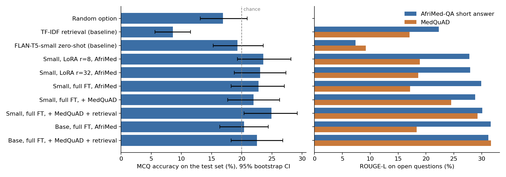

# AfriMed QA Assistant

A question-answering assistant for health questions, trained on medical questions written in African
medical schools. It answers short open questions and multiple-choice exam questions in English, and
refuses questions that are not about health.

- **GitHub:** https://github.com/nehemmy55/Summative-project-I
- **Live app:** https://afrimedi.streamlit.app/
- **Demo video:** TODO
- **Report:** [report/report.pdf](report/report.pdf)
- **Model weights:** https://huggingface.co/ishimwe5555/afrimed-qa

This is a course project and an educational prototype. The model is small and often wrong, so please
don't use it for real medical decisions.

## What the project is about

Big language models do well on medical exams, but they are expensive to run, and the AfriMed-QA paper
showed they do worse on questions from African medical schools than on US ones. I wanted to see what
happens at the other end: how far can I get with a model small enough to train and host for free?

So I fine-tuned FLAN-T5 (small, 77M parameters, and base, 248M) on AfriMed-QA and compared a few choices:
LoRA against full fine-tuning, adding extra data from MedQuAD, giving the model a retrieved passage as
context, and using a bigger model.

Short version of what I found: fine-tuning helps a lot on open questions, but none of the models answer
the multiple-choice exam questions better than guessing.

## Data

Everything is real, human-written data. I did not use any generated data.

- **AfriMed-QA v2.5** (main dataset, CC BY-NC-SA 4.0). I used the 3,723 multiple-choice questions that
  have one correct answer and the 1,236 short-answer questions. Most come from Nigeria, Ghana, Kenya and
  Malawi. The dataset also has 10,000 questions from the public, but those have no answers, so I could
  only use them to train the health / not-health classifier.
- **MedQuAD** (extra data, CC BY 4.0). 3,000 question-answer pairs from NIH websites for training, 200
  for testing, and more passages for retrieval. I left out the two sources about rare genetic diseases.
- **WebQuestions and TREC**. General questions, used as the "not health" class for the classifier.

Preparation is in `src/data_prep.py`: cleaning whitespace and broken characters, removing option labels
like "a." and "B)", dropping 315 questions with more than one correct option, cutting long reference
answers to about 45 words, and splitting 80/10/10. I made my own split because the official one puts
almost all the multiple-choice questions in the test part.

| Split | AfriMed MCQ | AfriMed short answer | MedQuAD | Total |
|---|---|---|---|---|
| Train | 2,978 | 989 | 3,000 | 6,967 |
| Validation | 372 | 124 | - | 496 |
| Test | 373 | 123 | 200 | 696 |

Some problems I ran into with the data: words stuck together from scanned exam papers ("thefollowing"),
spelling mistakes, a few answer keys that look wrong, and many short-answer questions that follow the same
template, so similar questions end up in both train and test.

## How it works

1. **Domain check.** A TF-IDF + logistic regression classifier decides if the question is about health.
   If not, the app refuses.
2. **Retrieval.** TF-IDF search finds the most similar entry in a knowledge base built from the training
   answers and MedQuAD passages.
3. **Answer generation.** The fine-tuned FLAN-T5 model gets the retrieved passage, the question and the
   options (if any) and generates the answer.

Training details: 3 epochs, batch size 8, AdamW, learning rate 3e-4 for full fine-tuning and 1e-3 for LoRA
(adapters on the attention query and value layers). I keep the checkpoint with the lowest validation loss.

For multiple-choice questions I measure accuracy (chance is 20% with five options). For open questions I
use token F1 and ROUGE-L, since a correct free-text answer almost never matches the reference word for word.

## Results

Test set results. The numbers in brackets are 95% confidence intervals.

| System | MCQ accuracy | Short answer F1 | Short answer ROUGE-L | MedQuAD ROUGE-L |
|---|---|---|---|---|
| Random option | 16.9 [13.1, 20.9] | 0.0 | 0.0 | 0.0 |
| Baseline: TF-IDF retrieval | 8.6 [5.6, 11.5] | 25.4 | 22.3 | 17.0 |
| Baseline: FLAN-T5-small, no fine-tuning | 19.3 [15.3, 23.6] | 7.5 | 7.4 | 9.2 |
| Small, LoRA r=8 | 23.6 [19.3, 28.1] | 32.0 | 27.8 | 18.9 |
| Small, LoRA r=32 | 23.1 [18.8, 27.4] | 31.9 | 27.9 | 18.6 |
| Small, full fine-tuning | 22.8 [18.2, 27.1] | 33.4 | 29.9 | 17.2 |
| Small, full + MedQuAD | 22.0 [17.7, 26.3] | 32.8 | 28.8 | 24.5 |
| **Small, full + MedQuAD + retrieval (deployed)** | 24.9 [20.4, 29.2] | 33.0 | 30.1 | 29.3 |
| Base, full fine-tuning | 20.4 [16.4, 24.4] | 35.4 | 31.6 | 18.3 |
| Base, full + MedQuAD + retrieval | 22.5 [18.2, 26.8] | 34.2 | 31.2 | 31.6 |

The health / not-health classifier gets 97.4% accuracy on 4,748 held-out questions.



What I take from this:

- **Multiple choice is basically at chance level.** All models are between 20% and 25%. Only the deployed
  one has a confidence interval that just misses 20%, and when I trained that same setup a first time it
  got 23.3%, so I don't read much into it. Even the bigger model does not help. The validation loss keeps going down, but
  that only means the model gets better at writing out an option, not at picking the right one.
- **Open questions improve a lot.** ROUGE-L goes from 7.4 without fine-tuning to around 30, which beats
  the retrieval baseline.
- **LoRA rank makes no difference** (r=8 and r=32 give the same scores). Full fine-tuning is about 2 points
  better.
- **MedQuAD only helps on MedQuAD-style questions.** It does nothing for the AfriMed questions.
- **Retrieval helps when the knowledge base has something close to the question,** and not otherwise.

I deployed the small model with retrieval. The base model is not clearly better on the AfriMed questions
and is three times bigger.

Some typical errors (more in [results/error_analysis.md](results/error_analysis.md), and every test
example with its error type in `results/error_table.csv`):

- The model picks option C too often (28% of the time).
- It writes fluent answers that are wrong. For example it said cataract is the leading cause of death in
  children under five in sub-Saharan Africa. The reference answer is malaria.
- For "Discuss ..." or "Write short notes on ..." questions it often just repeats the question.
- The classifier is not reliable on very short inputs like "hello", so the app asks for a full question.

## Limitations

- Not reliable enough for any medical use.
- English only. There is no data in Kinyarwanda, Swahili or other African languages.
- The test set is small, so 2-3 point differences between models don't mean much.
- ROUGE and F1 only measure word overlap. No doctor checked the answers.
- Each setup was trained once with one seed (the deployed one twice: 23.3% and 24.9% MCQ accuracy).
- One planned run (LoRA on FLAN-T5-base) crashed on Colab because of a library version problem, so it is
  not in the table.

## Running it

```bash
pip install -r requirements.txt datasets scipy matplotlib tabulate pytest

python -m src.data_prep                  # build the splits (already in data/processed)
python -m src.domain_gate                # train the health / not-health classifier
python -m src.evaluate --system tfidf    # baselines: random, tfidf, zeroshot
python -m src.train --name full_ft_rag --method full --data afrimed+medquad --rag
python -m src.analysis                   # tables, figures, error analysis
python -m pytest tests                   # quick checks of the metrics and the data splits

streamlit run app.py
```

The app loads the model from `models/final/` if it exists, otherwise it downloads it from
[ishimwe5555/afrimed-qa](https://huggingface.co/ishimwe5555/afrimed-qa) on the Hugging Face Hub (the weights are
too big for GitHub).

Training one small model takes about 1.5-2 hours on my laptop CPU and a few minutes on a Colab T4, so I
ran the later experiments with [notebooks/colab_experiments.ipynb](notebooks/colab_experiments.ipynb).

## Files

```
app.py                 Streamlit app
src/data_prep.py       cleaning, splitting, knowledge base
src/train.py           fine-tuning (full or LoRA)
src/evaluate.py        baselines and test evaluation
src/metrics.py         accuracy, F1, ROUGE, confidence intervals
src/retrieval.py       TF-IDF retriever
src/domain_gate.py     health / not-health classifier
src/qa_model.py        prompts, model loading, generation
src/inference.py       full pipeline used by the app
src/analysis.py        result tables, figures, error analysis
tests/                 small tests for the metrics, cleaning and splits
notebooks/             Colab notebook with the GPU runs
results/               metrics, predictions and figures for every run
report/                report source and PDF
```

## Credits

Datasets: AfriMed-QA, MedQuAD, WebQuestions, TREC. Pretrained model: FLAN-T5 from Google. Libraries:
PyTorch, Hugging Face Transformers and PEFT, scikit-learn, rouge-score, Streamlit. I used an AI coding
assistant for help with code and documentation.

## References

- Olatunji, T., et al. (2025). AfriMed-QA: A Pan-African, multi-specialty, medical question-answering benchmark dataset. ACL 2025.
- Ben Abacha, A., & Demner-Fushman, D. (2019). A question-entailment approach to question answering. BMC Bioinformatics, 20, 511.
- Chung, H. W., et al. (2022). Scaling instruction-finetuned language models. arXiv:2210.11416.
- Hu, E. J., et al. (2022). LoRA: Low-rank adaptation of large language models. ICLR 2022.
- Lewis, P., et al. (2020). Retrieval-augmented generation for knowledge-intensive NLP tasks. NeurIPS 2020.
- Lin, C.-Y. (2004). ROUGE: A package for automatic evaluation of summaries.
- Berant, J., et al. (2013). Semantic parsing on Freebase from question-answer pairs. EMNLP 2013.
- Li, X., & Roth, D. (2002). Learning question classifiers. COLING 2002.
